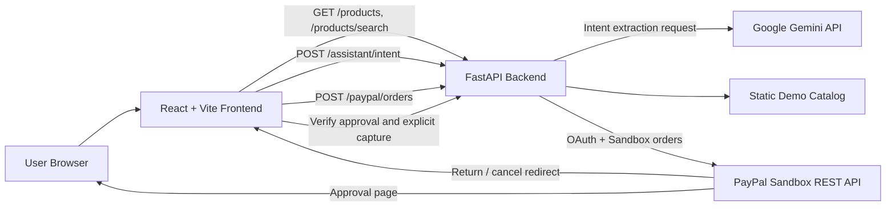

# CartPilot AI

**Your Personal Autonomous Shopping Agent**

CartPilot AI is a hackathon project that combines a React shopping interface with a FastAPI backend, Google Gemini intent extraction, a deterministic recommendation engine, and a PayPal Sandbox checkout flow.

Users describe what they need in natural language. Gemini extracts structured shopping requirements, and the backend filters and ranks products from a fixed demo catalog using explicit rules. The result is a transparent list of matches with scores and match reasons.

> **Important:** Products come from a static demo catalog. They are not live retailer inventory, prices, or availability.
>
> **Payment safety:** Checkout uses PayPal Sandbox only. No real payments are processed.
>
> **Not deployed:** This repository is a local development/hackathon project and is not currently deployed or publicly hosted.

Repository: <https://github.com/Plabon-Basak/CartPilot-AI>

---

## Table of Contents

- [Key Features](#key-features)
- [Screenshots](#screenshots)
- [Technology Stack](#technology-stack)
- [System Architecture and Request Flow](#system-architecture-and-request-flow)
- [Project Directory Structure](#project-directory-structure)
- [Prerequisites](#prerequisites)
- [Local Installation and Setup](#local-installation-and-setup)
- [Backend Environment Variables](#backend-environment-variables)
- [Frontend Environment Configuration](#frontend-environment-configuration)
- [How to Run the Backend and Frontend](#how-to-run-the-backend-and-frontend)
- [API Endpoint Documentation](#api-endpoint-documentation)
- [Testing Instructions and Verified Test Coverage](#testing-instructions-and-verified-test-coverage)
- [PayPal Sandbox Checkout Workflow](#paypal-sandbox-checkout-workflow)
- [Important Limitations and Security Notes](#important-limitations-and-security-notes)
- [Future Improvements](#future-improvements)

---

## Key Features

- **Natural-language shopping assistant** for queries such as “I need a laptop for university with 16GB RAM and 512GB SSD under $1000.”
- **Gemini-powered intent extraction** for category, keywords, budget, brand, RAM, storage capacity, storage type, currency, and use case.
- **Deterministic backend filtering and ranking** based on the extracted intent. Gemini does not choose products or invent prices.
- **Product-type normalization** with synonyms, such as laptop/notebook, phone/smartphone, and shoes/sneakers.
- **Hard constraint enforcement** for product type, category, price range, brand, RAM, storage capacity, and storage type.
- **Match scores and reasons** returned with each recommendation.
- **Static demo catalog** containing 25 products across five categories:
  - Electronics
  - Computers and accessories
  - Mobile phones
  - Clothing
  - Home and lifestyle
- **Catalog browsing, category filtering, keyword search, and product lookup endpoints.**
- **Persistent client-side cart** stored in `localStorage`, including quantity updates, removal, total calculation, and clear-cart confirmation.
- **PayPal Sandbox checkout** with order creation, approval verification, explicit user confirmation before capture, and cancellation handling.
- **Accessible navigation and controls**, including labels, button semantics, and `aria-current` on the active navigation item.

> Gemini is used only to extract shopping intent. Product filtering, constraint enforcement, scoring, and ranking are implemented in backend Python logic.

---

## Screenshots

Screenshots are not currently included in this repository. The placeholders below are intentionally not linked to image files.

| View | Placeholder |
| --- | --- |
| Main dashboard | _Screenshot placeholder: add a screenshot of the hero, assistant, product catalog, and cart interface._ |
| AI recommendations | _Screenshot placeholder: add a screenshot showing extracted intent, match scores, and recommendation reasons._ |
| PayPal Sandbox return | _Screenshot placeholder: add a screenshot showing approval verification and the explicit “Confirm Payment” step._ |

If screenshots are added later, place the real images in the repository and replace these placeholders with accurate relative links.

---

## Technology Stack

### Frontend

| Technology | Purpose |
| --- | --- |
| React 19 | Component-based single-page UI |
| TypeScript 5.8 | Type-safe frontend code |
| Vite 7 | Development server and production bundler |
| ESLint 9 | Static analysis |
| CSS | Component-level styling |
| Fetch API | Backend HTTP requests |
| `localStorage` | Client-side cart persistence |

### Backend

| Technology | Purpose |
| --- | --- |
| Python | Backend runtime |
| FastAPI | REST API framework |
| Uvicorn | ASGI development server |
| Pydantic v2 / pydantic-settings | Request validation and environment configuration |
| httpx | Calls to Gemini and PayPal APIs |
| pytest / FastAPI TestClient | Backend tests |

### External Services

| Service | Usage |
| --- | --- |
| Google Gemini API | Extracts structured shopping intent from user queries |
| PayPal REST API | Creates, verifies, and captures Sandbox orders |

Local verification was performed with Python 3.14.2, Node.js 24.19.0, npm 11.17.0, FastAPI 0.162.0, Uvicorn 0.54.0, Pydantic 2.14.1, pydantic-settings 2.16.1, httpx 0.28.1, and pytest 9.1.1.

The backend does not currently include a `requirements.txt`, `pyproject.toml`, or other dependency lock file. See [Prerequisites](#prerequisites) for the required packages.

---

## System Architecture and Request Flow



### AI Recommendation Flow

1. The user submits a shopping query from `AssistantPanel`.
2. The frontend sends `POST /assistant/intent` with `{ "query": "..." }`.
3. The backend builds an intent-extraction prompt and calls Gemini through `app/gemini.py`.
4. Gemini returns structured JSON describing the shopping intent.
5. The backend validates the response with Pydantic and normalizes product-type synonyms.
6. The backend iterates over the static demo catalog, applies hard constraints, calculates a score, and records human-readable match reasons.
7. Scores are normalized to a `0–100` range and sorted descending.
8. The frontend renders recommendation cards and allows products to be added to the cart.

Gemini is not trusted to return product IDs, prices, availability, or rankings. Tests verify that injected nonexistent products are not returned.

### Cart and Checkout Flow

1. Products are added to a React cart context and persisted in browser `localStorage`.
2. The cart total is calculated client-side.
3. “Checkout with PayPal” sends the total to `POST /paypal/orders`.
4. The backend obtains a PayPal OAuth token, creates a Sandbox order, and returns an approval URL.
5. The browser redirects to PayPal Sandbox for approval.
6. PayPal redirects to the configured frontend return URL, or to the backend redirect helper if configured that way.
7. The frontend verifies approval through `GET /paypal/orders/{order_id}/approval`.
8. The payment is captured only after the user clicks **Confirm Payment**.
9. On a `COMPLETED` capture, the frontend clears the cart.

### PayPal Redirect Notes

By default, the backend passes these frontend URLs to PayPal:

- Return: `http://localhost:5173/?paypal=return`
- Cancel: `http://localhost:5173/?paypal=cancel`

The backend also exposes `/paypal/return` and `/paypal/cancel` redirect helpers. They are useful only if the corresponding `FRONTEND_RETURN_URL` or `FRONTEND_CANCEL_URL` values are configured to point to those backend routes.

---

## Project Directory Structure

```text
CartPilot-AI/
├── .env.example                  # Safe root template for backend configuration
├── README.md
├── backend/
│   ├── .env.example              # Original backend template
│   ├── .gitignore
│   ├── app/
│   │   ├── __init__.py
│   │   ├── catalog.py            # Static 25-product demo catalog and search
│   │   ├── config.py             # Pydantic settings and defaults
│   │   ├── gemini.py             # Gemini generateContent integration
│   │   └── paypal.py             # PayPal Sandbox API integration
│   ├── main.py                   # FastAPI app, routes, intent matching/ranking
│   └── tests/
│       ├── test_assistant_intent.py
│       ├── test_catalog.py
│       ├── test_catalog_api.py
│       ├── test_cors.py
│       ├── test_gemini.py
│       ├── test_paypal.py
│       ├── test_product_type_preservation.py
│       └── test_relevance_ranking.py
└── frontend/
    ├── .env.development          # Development API base URL
    ├── .gitignore
    ├── index.html
    ├── package.json
    ├── package-lock.json
    ├── public/
    │   ├── favicon.svg
    │   └── icons.svg
    ├── src/
    │   ├── api/
    │   │   ├── assistant.ts
    │   │   ├── client.ts
    │   │   ├── paypal.ts
    │   │   └── products.ts
    │   ├── assets/
    │   │   └── hero.png
    │   ├── components/
    │   │   ├── AssistantPanel.css
    │   │   ├── AssistantPanel.tsx
    │   │   ├── Hero.css
    │   │   ├── Hero.tsx
    │   │   ├── Navbar.css
    │   │   ├── Navbar.tsx
    │   │   ├── PayPalReturn.css
    │   │   ├── PayPalCancel.tsx
    │   │   ├── PayPalReturn.tsx
    │   │   ├── ProductDiscovery.css
    │   │   ├── ProductDiscovery.tsx
    │   │   ├── ShoppingCart.css
    │   │   └── ShoppingCart.tsx
    │   ├── context/
    │   │   ├── CartContext.tsx
    │   │   ├── cartContext.ts
    │   │   └── useCart.ts
    │   ├── App.css
    │   ├── App.tsx
    │   ├── index.css
    │   ├── main.tsx
    │   └── vite-env.d.ts
    ├── tsconfig.app.json
    ├── tsconfig.json
    ├── tsconfig.node.json
    └── vite.config.ts
```

Generated folders such as `frontend/dist`, `frontend/node_modules`, `backend/.venv`, `__pycache__`, and `.pytest_cache` are intentionally omitted from the tree.

---

## Prerequisites

Install the following before running the project:

- **Git**
- **Python 3.10 or newer**\
  The code uses modern type syntax such as `str | None`. Local verification used Python 3.14.2.
- **Node.js 20.19+ or 22.12+**\
  This is the engine requirement declared by Vite 7. Local verification used Node.js 24.19.0.
- **npm**
- A **Google Gemini API key** for the AI assistant endpoint.
- A **PayPal Developer Sandbox account** with Sandbox REST API credentials.
- Windows PowerShell for the commands below. The project also runs on macOS/Linux, but this guide uses PowerShell syntax.

---

## Local Installation and Setup

### 1. Clone the repository

```powershell
git clone https://github.com/Plabon-Basak/CartPilot-AI.git
Set-Location "CartPilot-AI"
```

### 2. Create the backend virtual environment

```powershell
Set-Location backend
python -m venv .venv
.\.venv\Scripts\Activate.ps1
```

If PowerShell blocks virtual-environment activation, allow it for the current PowerShell session only:

```powershell
Set-ExecutionPolicy -Scope Process -ExecutionPolicy Bypass
.\.venv\Scripts\Activate.ps1
```

### 3. Install backend dependencies

The repository does not currently contain a backend dependency lock file. Install the packages used by the application and tests:

```powershell
python -m pip install --upgrade pip
python -m pip install fastapi uvicorn pydantic-settings httpx pytest
```

### 4. Create the backend environment file

From the repository root:

```powershell
Set-Location ..
Copy-Item .env.example backend\.env
notepad backend\.env
```

The original `backend/.env.example` can also be used, but the root template includes the optional frontend return/cancel URL and Gemini model settings that are read by `backend/app/config.py`.

Fill in Sandbox/test values only. Never commit the resulting `.env` file.

### 5. Install frontend dependencies

```powershell
Set-Location frontend
npm ci
```

Use `npm install` instead of `npm ci` if you intentionally update dependencies.

The tracked `frontend/.env.development` already points the frontend at `http://localhost:8000`. No frontend secrets are required.

---

## Backend Environment Variables

The backend reads `backend/.env` when Uvicorn is started from the `backend` directory.

The root `.env.example` contains placeholder values only:

```env
PAYPAL_MODE=sandbox
PAYPAL_CLIENT_ID=your_paypal_sandbox_client_id
PAYPAL_CLIENT_SECRET=your_paypal_sandbox_client_secret
PAYPAL_BASE_URL=https://api-m.sandbox.paypal.com

FRONTEND_RETURN_URL=http://localhost:5173/?paypal=return
FRONTEND_CANCEL_URL=http://localhost:5173/?paypal=cancel

GEMINI_API_KEY=your_gemini_api_key
GEMINI_MODEL=your_available_gemini_model
```

| Variable | Required | Default in code | Notes |
| --- | --- | --- | --- |
| `PAYPAL_MODE` | No | `sandbox` | The backend rejects any mode other than `sandbox`. |
| `PAYPAL_CLIENT_ID` | Yes | None | PayPal Sandbox REST app client ID. No secret should ever be committed. |
| `PAYPAL_CLIENT_SECRET` | Yes | None | PayPal Sandbox REST app secret. Keep server-side only. |
| `PAYPAL_BASE_URL` | No | `https://api-m.sandbox.paypal.com` | Sandbox PayPal REST base URL. |
| `FRONTEND_RETURN_URL` | No | `http://localhost:5173/?paypal=return` | Return URL sent to PayPal in the order application context. |
| `FRONTEND_CANCEL_URL` | No | `http://localhost:5173/?paypal=cancel` | Cancel URL sent to PayPal in the order application context. |
| `GEMINI_API_KEY` | Recommended | `None` | Without it, `/assistant/intent` returns a configuration error. |
| `GEMINI_MODEL` | No | `gemini-3.5-flash` | Model name passed to the Gemini `generateContent` endpoint. Verify that the selected model is available to your API key. |

The settings class requires `PAYPAL_CLIENT_ID` and `PAYPAL_CLIENT_SECRET` to be present, even when running mocked tests. Create `backend/.env` before starting the app or running the test suite.

**Security:** `.env` files are ignored by Git. Use Sandbox credentials only. Do not paste real credentials into documentation, screenshots, issues, or commits.

---

## Frontend Environment Configuration

The frontend requires `VITE_API_BASE_URL`. The API client throws an explicit error if it is missing.

Tracked development value:

```env
VITE_API_BASE_URL=http://localhost:8000
```

Located at `frontend/.env.development`.

To override it locally without modifying tracked files:

```powershell
Set-Location frontend
Copy-Item .env.development .env.local
notepad .env.local
```

`frontend/.gitignore` ignores `*.local`, so `.env.local` is suitable for machine-specific values. Vite embeds `VITE_*` values into the client bundle at build time; never place secrets in frontend environment variables.

For a non-local frontend build, set `VITE_API_BASE_URL` to the backend URL that will serve the frontend. No production deployment is provided or claimed by this repository.

---

## How to Run the Backend and Frontend

Use two PowerShell terminals.

### Terminal 1: Backend

```powershell
Set-Location "D:\path\to\CartPilot-AI\backend"
.\.venv\Scripts\Activate.ps1
uvicorn main:app --reload --host 127.0.0.1 --port 8000
```

Backend URL:

```text
http://127.0.0.1:8000
```

Interactive API documentation is available at:

- `http://127.0.0.1:8000/docs`
- `http://127.0.0.1:8000/redoc`

### Terminal 2: Frontend

```powershell
Set-Location "D:\path\to\CartPilot-AI\frontend"
npm run dev
```

Vite serves the frontend at:

```text
http://localhost:5173
```

The backend CORS configuration currently allows only these local frontend origins:

- `http://localhost:5173`
- `http://127.0.0.1:5173`

If you use a different frontend port or host, update the CORS configuration in `backend/main.py`.

### Frontend production build

```powershell
Set-Location "D:\path\to\CartPilot-AI\frontend"
npm run build
```

This runs TypeScript compilation and creates a Vite production bundle in `frontend/dist`. The repository does not include deployment configuration for that bundle.

---

## API Endpoint Documentation

Base URL for local development:

```text
http://127.0.0.1:8000
```

FastAPI also exposes:

| Method | Path | Purpose |
| --- | --- | --- |
| `GET` | `/docs` | Swagger UI |
| `GET` | `/redoc` | ReDoc UI |
| `GET` | `/openapi.json` | OpenAPI schema |

### Application and Catalog Endpoints

| Method | Path | Query / Body | Response |
| --- | --- | --- | --- |
| `GET` | `/` | None | Welcome message, status, and API version |
| `GET` | `/health` | None | Health status |
| `GET` | `/products` | Optional `category` query | Demo catalog products, optional exact category filter |
| `GET` | `/products/search` | `q` required; optional `category`, `max_results` | Keyword search results |
| `GET` | `/products/{product_id}` | Path parameter | Product detail or `404` |

#### `GET /products`

Optional category filter example:

```text
GET /products?category=Electronics
```

Response for the example filter:

```json
{
  "source": "demo_catalog",
  "count": 5,
  "products": [
    {
      "id": "prod-001",
      "name": "Wireless Noise Cancelling Headphones",
      "category": "Electronics",
      "description": "Over-ear headphones with active noise cancellation and 30-hour battery life.",
      "price": 199.99,
      "currency": "USD",
      "brand": "SoundWave",
      "availability": "in_stock"
    },
    {
      "id": "prod-002",
      "name": "True Wireless Earbuds",
      "category": "Electronics",
      "description": "Compact earbuds with touch controls and sweat resistance.",
      "price": 89.49,
      "currency": "USD",
      "brand": "AudioPulse",
      "availability": "in_stock"
    },
    {
      "id": "prod-003",
      "name": "Bluetooth Speaker Mini",
      "category": "Electronics",
      "description": "Portable speaker with rich sound and water-resistant design.",
      "price": 49.95,
      "currency": "USD",
      "brand": "BoomBox",
      "availability": "in_stock"
    },
    {
      "id": "prod-004",
      "name": "4K Action Camera",
      "category": "Electronics",
      "description": "Compact action camera for recording adventures in 4K resolution.",
      "price": 149.0,
      "currency": "USD",
      "brand": "AdventureCam",
      "availability": "in_stock"
    },
    {
      "id": "prod-021",
      "name": "Wireless Charger Stand",
      "category": "Electronics",
      "description": "Vertical wireless charging stand for phones and earbuds.",
      "price": 39.99,
      "currency": "USD",
      "brand": "ChargeLink",
      "availability": "in_stock"
    }
  ]
}
```

Category matching is case-insensitive and compares the full category string.

#### `GET /products/search`

Query parameters:

| Parameter | Required | Validation |
| --- | --- | --- |
| `q` | Yes | Minimum length 1 |
| `category` | No | Exact category filter, case-insensitive |
| `max_results` | No | Integer from `1` to `50`; default `10` |

Example:

```text
GET /products/search?q=headphones&max_results=5
```

Response shape:

```json
{
  "source": "demo_catalog",
  "query": "headphones",
  "count": 1,
  "products": [
    {
      "id": "prod-001",
      "name": "Wireless Noise Cancelling Headphones",
      "category": "Electronics",
      "description": "Over-ear headphones with active noise cancellation and 30-hour battery life.",
      "price": 199.99,
      "currency": "USD",
      "brand": "SoundWave",
      "availability": "in_stock"
    }
  ]
}
```

Name matches are returned before description/category/brand matches.

#### `GET /products/{product_id}`

Example:

```text
GET /products/prod-001
```

Response:

```json
{
  "source": "demo_catalog",
  "product": {
    "id": "prod-001",
    "name": "Wireless Noise Cancelling Headphones",
    "category": "Electronics",
    "description": "Over-ear headphones with active noise cancellation and 30-hour battery life.",
    "price": 199.99,
    "currency": "USD",
    "brand": "SoundWave",
    "availability": "in_stock"
  }
}
```

Unknown IDs return `404` with `{ "detail": "Product not found" }`.

### AI Assistant Endpoint

#### `POST /assistant/intent`

Request body:

```json
{
  "query": "I need headphones under $200"
}
```

`query` must be a non-empty string.

Illustrative response:

```json
{
  "source": "demo_catalog",
  "query": "I need headphones under $200",
  "intent": {
    "category": "Electronics",
    "keywords": ["headphones"],
    "min_ram_gb": null,
    "max_ram_gb": null,
    "min_storage_gb": null,
    "max_storage_gb": null,
    "storage_type": null,
    "max_price": 200.0,
    "min_price": null,
    "brand": null,
    "currency": "USD",
    "use_case": null
  },
  "matches": [
    {
      "product": {
        "id": "prod-001",
        "name": "Wireless Noise Cancelling Headphones",
        "category": "Electronics",
        "description": "Over-ear headphones with active noise cancellation and 30-hour battery life.",
        "price": 199.99,
        "currency": "USD",
        "brand": "SoundWave",
        "availability": "in_stock"
      },
      "score": 100,
      "reasons": [
        "Matches product type",
        "Matches category",
        "Under budget"
      ]
    }
  ],
  "count": 1
}
```

Scores are normalized to `0–100` and sorted descending. The exact extracted intent depends on the Gemini response; the backend then enforces constraints against the demo catalog.

Error behavior:

| Status | Cause |
| --- | --- |
| `400` | Missing Gemini API key, invalid Gemini response format, or invalid intent structure |
| `502` | Gemini request failure or malformed upstream response |
| `422` | Request validation failure, such as an empty query |

Intent extraction covers category, keywords, minimum/maximum RAM, minimum/maximum storage, storage type, minimum/maximum price, brand, currency, and use case. Current matching logic enforces product type, category, price, brand, RAM, and storage constraints; `use_case` and `currency` are returned in the intent but do not currently affect ranking or checkout currency.

### PayPal Sandbox Endpoints

The PayPal API-backed routes require `PAYPAL_MODE=sandbox`. The `/paypal/return` and `/paypal/cancel` redirect helpers do not check the mode themselves.

| Method | Path | Request | Response |
| --- | --- | --- | --- |
| `POST` | `/paypal/orders` | `{ "amount": "10.00" }` | `{ id, status, approval_url }` |
| `GET` | `/paypal/orders/{order_id}` | Path parameter | `{ id, status, intent, amount }` |
| `GET` | `/paypal/orders/{order_id}/approval` | Path parameter | `{ id, status, approved }` |
| `POST` | `/paypal/orders/{order_id}/capture` | Path parameter | `{ id, status }` |
| `GET` | `/paypal/return` | Optional `token` query | `302` redirect or `400` |
| `GET` | `/paypal/cancel` | None | `302` redirect |

#### `POST /paypal/orders`

The amount must be a positive decimal with at most two decimal places. The backend always creates the PayPal order in `USD`.

Example request:

```json
{
  "amount": "10.00"
}
```

Response:

```json
{
  "id": "PAYPAL_ORDER_ID",
  "status": "CREATED",
  "approval_url": "https://www.sandbox.paypal.com/..."
}
```

Possible errors:

- `502` when PayPal credentials, the PayPal API, or the approval URL are unavailable.
- The backend does not accept amounts less than or equal to zero.

#### `GET /paypal/orders/{order_id}`

Returns the PayPal order status and amount as reported by PayPal.

#### `GET /paypal/orders/{order_id}/approval`

Returns `approved: true` only when PayPal reports the order status as `APPROVED`.

#### `POST /paypal/orders/{order_id}/capture`

The backend re-fetches the order and refuses to capture unless the status is `APPROVED`.

Possible errors:

- `400` when the order has not been approved.
- `502` when PayPal capture fails.

#### `GET /paypal/return`

Accepts a PayPal `token` query parameter. Without a token, returns `400`. With a token, redirects to the configured frontend return URL with the token appended.

#### `GET /paypal/cancel`

Redirects to the configured frontend cancel URL.

### CORS Configuration

Current allowed origins:

- `http://localhost:5173`
- `http://127.0.0.1:5173`

Allowed methods: `GET`, `POST`, `OPTIONS`\
Allowed headers: `Content-Type`, `Authorization`\
Credentials are not enabled.

---

## Testing Instructions and Verified Test Coverage

### Backend tests

From the `backend` directory with the virtual environment active:

```powershell
Set-Location "D:\path\to\CartPilot-AI\backend"
.\.venv\Scripts\Activate.ps1
python -m pytest -q
```

Verified result in this environment:

```text
60 passed, 1 warning in 1.53s
```

The warning is:

```text
StarletteDeprecationWarning: Using `httpx` with `starlette.testclient` is deprecated; install `httpx2` instead.
```

The suite contains 60 tests across eight files:

| Test file | Focus |
| --- | --- |
| `test_assistant_intent.py` | Intent validation, filtering, ranking, brands, RAM/storage, prompt-injection resistance |
| `test_catalog.py` | Demo catalog access, search, filtering, limits, and priorities |
| `test_catalog_api.py` | Product, search, and detail API behavior |
| `test_cors.py` | Allowed and disallowed local origins |
| `test_gemini.py` | Gemini success, missing key, API error, and malformed response handling |
| `test_paypal.py` | Mocked OAuth, order creation/retrieval, approval, capture rejection, and API errors |
| `test_product_type_preservation.py` | Product-type synonyms and keyword preservation |
| `test_relevance_ranking.py` | Relevance rules and normalized scores |

The external Gemini and PayPal calls in the test suite are mocked, so the tests do not contact Gemini or PayPal and do not perform real payments. Because the settings class requires PayPal credential values, create `backend/.env` before running the tests.

There is no line-coverage percentage tool configured in the repository, so no coverage percentage is claimed.

### Frontend checks

The frontend currently has no automated unit, integration, or end-to-end test suite. The available checks are linting and a production build:

```powershell
Set-Location "D:\path\to\CartPilot-AI\frontend"
npm run lint
npm run build
```

Verified results:

```text
npm run lint
> eslint .
```
Completed with no reported errors or warnings.

```text
npm run build
> tsc -b && vite build
✓ 50 modules transformed.
✓ built in 1.38s
```

---

## PayPal Sandbox Checkout Workflow

1. **Add products to the cart.**\
   Products come from the static demo catalog. The cart is stored in browser `localStorage`.

2. **Start checkout.**\
   The frontend calculates the cart total and calls `POST /paypal/orders` with the amount formatted to two decimal places.

3. **Create the PayPal Sandbox order.**\
   The backend:
   - Rejects any mode other than `sandbox`.
   - Requests a PayPal OAuth access token.
   - Creates a PayPal order with `intent: CAPTURE`.
   - Sets `user_action` to `PAY_NOW` and `shipping_preference` to `NO_SHIPPING`.
   - Returns the approval URL.

4. **Approve in PayPal Sandbox.**\
   The browser is redirected to PayPal. The user must approve the payment in the Sandbox interface.

5. **Return to the application.**\
   By default, PayPal redirects to the frontend return URL, for example:
   ```text
   http://localhost:5173/?paypal=return&token=PAYPAL_ORDER_ID
   ```
   The frontend opens the PayPal return view and verifies the order status through the backend.

6. **Explicit capture confirmation.**\
   Approval does not automatically trigger capture. The user must click **Confirm Payment**. Only then does the frontend call `POST /paypal/orders/{order_id}/capture`.

7. **Capture verification.**\
   The backend re-fetches the PayPal order and requires an `APPROVED` status before capture. A successful capture returns a status such as `COMPLETED`.

8. **Cart cleanup.**\
   The frontend clears the cart only when the capture response status is `COMPLETED`.

9. **Cancellation.**\
   If the user cancels in PayPal, they are sent to the cancel view. No payment is captured.

**No real payments are processed.** All PayPal operations are intended for Sandbox testing only.

---

## Important Limitations and Security Notes

### Data and product limitations

- **Static demo catalog:** The catalog is a fixed list of 25 demo products in `backend/app/catalog.py`. It is not connected to any retailer, inventory system, pricing feed, or availability service.
- **Not live pricing:** All prices, brands, descriptions, and `in_stock` statuses are demo data.
- **No fulfillment:** There is no shipping, tax calculation, inventory reservation, order fulfillment, or real merchant integration.
- **Regex-based specifications:** RAM and storage constraints are parsed from product description text. Products without parseable specifications cannot satisfy those constraints.
- **Limited catalog coverage:** Only the five categories and 25 products in the demo catalog are searchable.
- **Unused intent fields:** `currency` and `use_case` are extracted and returned but are not used by the current filtering/ranking logic. Checkout is fixed to USD.
- **All demo products are marked in stock:** Availability is static demo metadata, not a real inventory signal.

### AI behavior and limitations

- Gemini is used for intent extraction only. It does not select final products, set prices, or access the catalog.
- The backend validates Gemini output and rejects malformed intent JSON.
- The backend ignores any product IDs or product lists returned by Gemini.
- The quality of natural-language parsing depends on the Gemini model and prompt. Users should verify extracted intent before relying on recommendations.
- A missing `GEMINI_API_KEY` causes `/assistant/intent` to fail with a configuration error.

### Payment and checkout limitations

- **Sandbox only:** The backend explicitly refuses to operate unless `PAYPAL_MODE=sandbox`.
- **No real money:** PayPal Sandbox accounts and test transactions must be used.
- **Explicit capture:** Approval alone does not capture payment. The user must click **Confirm Payment**, and the backend requires an `APPROVED` PayPal order before capture.
- **Client-supplied amount:** The amount sent to PayPal is calculated by the frontend from the local cart. The backend validates that it is positive but does not bind it to a server-side cart or product inventory. A production system must validate the amount server-side.
- **No order ownership binding:** The backend verifies PayPal order status but does not associate orders with authenticated users, carts, or checkout sessions.
- **No webhook verification or reconciliation:** The flow relies on the synchronous return and capture path.
- **No shipping/tax:** Orders use `NO_SHIPPING`; taxes and fulfillment are outside the project scope.
- **Query-string order token:** The PayPal order token is handled in the frontend return URL. The project does not implement an additional state/nonce or CSRF binding.

### Application and operational limitations

- **No authentication or user accounts:** The profile area is not a functional account system. Cart data belongs to the browser.
- **Client-side cart only:** Cart contents can be lost if browser storage is cleared or unavailable.
- **Local CORS allowlist:** Only `localhost:5173` and `127.0.0.1:5173` are allowed. Any other frontend origin requires a code change.
- **No deployment configuration:** This repository does not include a deployed backend, hosted frontend, database, container setup, or production reverse-proxy configuration.
- **No rate limiting:** The backend does not rate-limit intent or PayPal endpoints. Do not expose it publicly without adding authentication, abuse controls, and monitoring.
- **Upstream error exposure:** Some PayPal creation errors include upstream response text in the API error detail. Production deployments should sanitize upstream errors and avoid leaking service responses.
- **No frontend automated tests:** Linting and production builds are the only automated frontend checks.
- **No backend dependency lock file:** Backend package versions are not pinned in the repository.
- **Generation metadata:** `frontend/index.html` still uses the generic page title `frontend`.
- **Test warning:** The backend suite emits a known Starlette/httpx deprecation warning.

### Secret-handling notes

- Keep `PAYPAL_CLIENT_SECRET` and `GEMINI_API_KEY` in `backend/.env` only.
- Never commit `.env` files, credentials, Sandbox account passwords, or access tokens.
- Do not place secrets in any `VITE_*` variable; Vite variables are bundled into client-side code.
- Use placeholder values in documentation and examples, as shown in this README and `.env.example`.

---

## Future Improvements

- Replace the static demo catalog with a real product/inventory/pricing provider and product images.
- Store carts and orders server-side and calculate payment amounts from a server-validated cart.
- Add user authentication and bind PayPal orders to a specific user and checkout session.
- Add and validate a state/nonce value for PayPal return handling.
- Add PayPal webhook handling, idempotent capture, and payment reconciliation.
- Use Gemini structured-output schemas for more reliable intent JSON.
- Store RAM, storage, brand, and other specifications as structured product fields instead of parsing free-text descriptions.
- Use the extracted `currency` and `use_case` fields in matching and checkout, or remove them if not needed.
- Add configurable CORS/allowed origins for non-local environments.
- Add rate limiting, structured logging, monitoring, and sanitized upstream error handling.
- Add a backend `requirements.txt` or `pyproject.toml` with pinned versions.
- Add frontend unit/integration tests and end-to-end checkout tests with a browser automation tool.
- Add backend coverage reporting and CI for lint, build, and tests.
- Add real screenshots, product imagery, and a proper page title, description, and social preview metadata.
- Improve responsive and accessibility testing across browsers and assistive technologies.
- Add shipping, tax, discounts, and order-history support if the project moves beyond a demo.
- Add a containerized development setup and deployment documentation when a real deployment target exists.

---

## Disclaimer

CartPilot AI is a demonstration project. It uses a static demo catalog, simulated Sandbox payments, and mocked tests for external services. It is not a production commerce system and must not be used to process real payments or represent real retailer inventory or pricing.
