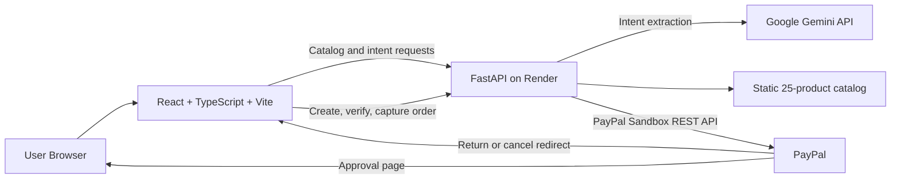

# CartPilot AI

**Your personal AI shopping agent for natural-language product discovery.**

CartPilot AI is a full-stack hackathon project that turns a plain-language shopping request into structured intent, ranked product recommendations, and a PayPal Sandbox checkout. Gemini extracts what the user is looking for; the backend applies deterministic filters and scoring against a fixed 25-product demo catalog, so every recommendation is explainable.

[Live frontend](https://cartpilot-ai-two.vercel.app/) | [Backend health](https://cartpilot-ai-backend.onrender.com/health) | [API docs](https://cartpilot-ai-backend.onrender.com/docs) | [GitHub repository](https://github.com/Plabon-Basak/CartPilot-AI)

> **PayPal Sandbox only:** CartPilot AI is a demonstration project. Checkout runs exclusively against PayPal Sandbox test accounts. No real money is charged, captured, or transferred.

---

## Overview

Shopping search usually requires users to translate a goal into the right keywords, filters, and product categories. CartPilot AI lets users describe the goal directly, for example:

> “I need a laptop for university with 16GB RAM and a 512GB SSD under $1000.”

The assistant extracts the relevant intent, the backend enforces hard constraints, and the UI explains why each product matched. The result is a transparent demo of AI-assisted commerce rather than a black-box recommendation feed.

The catalog is static demo data. The project does not connect to live retailer inventory, prices, availability, fulfillment, shipping, or tax systems.

---

## Live Demo

| Resource | URL |
| --- | --- |
| Frontend | <https://cartpilot-ai-two.vercel.app/> |
| Backend API | <https://cartpilot-ai-backend.onrender.com> |
| Backend health check | <https://cartpilot-ai-backend.onrender.com/health> |
| Interactive API docs | <https://cartpilot-ai-backend.onrender.com/docs> |
| Source code | <https://github.com/Plabon-Basak/CartPilot-AI> |

The live frontend is deployed on Vercel and calls the FastAPI backend deployed on Render.

---

## Key Features

- **Natural-language shopping assistant** powered by Gemini intent extraction.
- **Deterministic recommendation engine** implemented in Python, with hard constraints for product type, category, price, brand, RAM, and storage.
- **Transparent match scores and reasons** returned with every recommendation.
- **Product discovery UI** with category filters and a 25-product demo catalog across five categories.
- **Persistent client-side cart** stored in browser `localStorage`, with quantity updates, removal, totals, and clear-cart confirmation.
- **PayPal Sandbox checkout** covering order creation, approval verification, explicit user confirmation, capture, and cancellation.
- **Responsive, accessible controls** with labeled inputs, button semantics, focus-visible styles, and active-navigation state.
- **Backend regression coverage** for intent extraction, product matching, ranking, API behavior, CORS, Gemini handling, and PayPal handling.

---

## User Journey

1. Browse the product catalog or describe a shopping goal in the assistant.
2. The frontend sends the query to `POST /assistant/intent`.
3. Gemini extracts structured intent; the backend validates it, filters the demo catalog, scores candidates, and returns match reasons.
4. Add recommended or browsed products to the cart.
5. Select **Checkout with PayPal** to create a PayPal Sandbox order.
6. Approve the order on PayPal’s Sandbox checkout page.
7. Return to CartPilot AI, verify the approval, and explicitly select **Confirm Payment**.
8. The cart is cleared after a `COMPLETED` capture.

---

## Architecture



### Request flow

- **Catalog browsing:** the frontend calls `GET /products`, `GET /products/search`, or `GET /products/{product_id}`.
- **AI recommendations:** the frontend calls `POST /assistant/intent`; FastAPI asks Gemini for structured intent, then applies deterministic filtering and ranking.
- **Checkout:** the frontend sends the cart amount to `POST /paypal/orders`; the backend creates a Sandbox order and returns an approval URL.
- **Payment completion:** after approval, the frontend verifies the order and calls the capture endpoint only after explicit user confirmation.

There is no database. Products come from `backend/app/catalog.py`, and the cart lives in the browser.

---

## Technology Stack

### Frontend

| Technology | Purpose |
| --- | --- |
| React 19 | Component-based single-page UI |
| TypeScript 5.8 | Type-safe frontend code |
| Vite 7 | Development server and production build |
| ESLint 9 | Static analysis |
| Fetch API | Backend HTTP requests |
| `localStorage` | Client-side cart persistence |

### Backend

| Technology | Purpose |
| --- | --- |
| Python | Backend runtime |
| FastAPI | REST API framework |
| Uvicorn | ASGI server |
| Pydantic v2 | Request and response validation |
| pydantic-settings | Environment configuration |
| httpx | Gemini and PayPal API calls |
| pytest | Backend test suite |

### External Services

| Service | Usage |
| --- | --- |
| Google Gemini API | Extracts structured shopping intent from natural-language queries |
| PayPal Sandbox REST API | Creates, verifies, and captures Sandbox orders |

---

## How the Gemini Recommendation Flow Works

Gemini is used for **intent extraction only**. It does not choose products, set prices, or control ranking.

1. The frontend sends `{ "query": "..." }` to `POST /assistant/intent`.
2. `backend/app/gemini.py` calls the Gemini `generateContent` endpoint with an intent-extraction prompt.
3. Gemini returns structured JSON describing category, keywords, budget, brand, RAM, storage, currency, and use case.
4. The backend validates the response with Pydantic and rejects malformed intent.
5. The backend normalizes product-type synonyms and applies hard constraints against the static catalog.
6. Candidate products receive deterministic scores and human-readable match reasons.
7. Scores are normalized to `0–100`, sorted descending, and returned to the frontend.

The backend ignores any product IDs, prices, or product lists that Gemini might return. Recommendation behavior is implemented in `backend/main.py`; catalog data lives in `backend/app/catalog.py`.

Gemini requests include retries for transient failures, explicit timeouts, and a total request budget. User-facing errors are returned as controlled API errors rather than raw upstream responses.

---

## PayPal Sandbox Checkout

CartPilot AI uses the PayPal REST API in Sandbox mode.

1. The cart total is calculated in the browser.
2. The frontend sends the amount to `POST /paypal/orders`.
3. The backend obtains a PayPal OAuth token and creates a Sandbox order in `USD`.
4. The backend returns PayPal’s approval URL.
5. The browser redirects to PayPal Sandbox for approval.
6. PayPal redirects to the configured return or cancel URL.
7. On return, the frontend calls `GET /paypal/orders/{order_id}/approval`.
8. If the order is `APPROVED`, the user must explicitly select **Confirm Payment**.
9. The backend re-checks the order and calls `POST /paypal/orders/{order_id}/capture`.
10. The cart is cleared after a `COMPLETED` capture.

### Sandbox-only payment notice

- `PAYPAL_MODE` must be `sandbox`; the backend rejects other modes.
- Use PayPal Developer Sandbox accounts and test cards only.
- **No real money is charged.** The project is a hackathon demonstration, not a production payment system.
- There is no shipping, tax, inventory reservation, order fulfillment, or real merchant integration.

### Redirect configuration

The backend sends these frontend URLs to PayPal:

```env
FRONTEND_RETURN_URL=http://localhost:5173/?paypal=return
FRONTEND_CANCEL_URL=http://localhost:5173/?paypal=cancel
```

For the live deployment, these values are configured to the Vercel frontend origin. The backend also exposes `/paypal/return` and `/paypal/cancel` redirect helpers.

---

## Project Structure

```text
CartPilot-AI/
├── .env.example                     # Backend environment template
├── README.md
├── docs/                            # Reserved for submission assets; currently empty
├── backend/
│   ├── .env.example
│   ├── requirements.txt
│   ├── main.py                      # FastAPI app, routes, intent matching and ranking
│   ├── app/
│   │   ├── catalog.py               # Static 25-product demo catalog and search
│   │   ├── config.py                # Environment-backed settings
│   │   ├── gemini.py                # Gemini generateContent integration
│   │   └── paypal.py                # PayPal Sandbox integration
│   └── tests/
│       ├── test_assistant_intent.py
│       ├── test_catalog.py
│       ├── test_catalog_api.py
│       ├── test_cors.py
│       ├── test_gemini.py
│       ├── test_intent_matching_regressions.py
│       ├── test_paypal.py
│       ├── test_product_type_preservation.py
│       └── test_relevance_ranking.py
└── frontend/
    ├── .env.development
    ├── package.json
    ├── package-lock.json
    ├── index.html
    ├── public/
    └── src/
        ├── api/
        ├── components/
        ├── context/
        ├── App.tsx
        └── main.tsx
```

Generated folders such as `frontend/dist`, `frontend/node_modules`, `backend/.venv`, `__pycache__`, and `.pytest_cache` are intentionally excluded from version control.

---

## Local Development

### Prerequisites

- Git
- Python 3.10 or newer
- Node.js 20.19+ or 22.12+
- npm
- A Google Gemini API key
- A PayPal Developer Sandbox REST app with a client ID and secret

The examples below use PowerShell. The application also runs on macOS and Linux with equivalent commands.

### 1. Clone the repository

```powershell
git clone https://github.com/Plabon-Basak/CartPilot-AI.git
Set-Location "CartPilot-AI"
```

### 2. Set up the backend

```powershell
Set-Location backend
python -m venv .venv
.\.venv\Scripts\Activate.ps1
python -m pip install --upgrade pip
python -m pip install -r requirements.txt
python -m pip install pytest
```

`pytest` is used by the test suite and is not listed in the runtime `requirements.txt`.

Create the environment file:

```powershell
Copy-Item .env.example .env
notepad .env
```

Fill in Sandbox credentials and a Gemini API key. Never commit `.env`.

Start the API from the `backend` directory:

```powershell
uvicorn main:app --reload --host 127.0.0.1 --port 8000
```

Local backend URLs:

- API: <http://127.0.0.1:8000>
- API docs: <http://127.0.0.1:8000/docs>
- Health: <http://127.0.0.1:8000/health>

### 3. Set up the frontend

Open a second terminal at the repository root:

```powershell
Set-Location frontend
npm ci
npm run dev
```

Vite serves the frontend at <http://localhost:5173>.

The tracked `frontend/.env.development` contains:

```env
VITE_API_BASE_URL=http://localhost:8000
```

No frontend secrets are required. Vite embeds `VITE_*` values into the client bundle, so never place credentials in a frontend environment variable.

If port `5173` is unavailable or you use a different origin, update `CORS_ALLOW_ORIGINS` on the backend.

### 4. Run the backend tests

Open a third terminal at the repository root:

```powershell
Set-Location backend
.\.venv\Scripts\Activate.ps1
python -m pytest -q
```

The backend settings require `PAYPAL_CLIENT_ID` and `PAYPAL_CLIENT_SECRET` to be present, even when external calls are mocked, so create `backend/.env` before running the suite.

---

## Environment Variables

### Backend

The backend reads `backend/.env` when Uvicorn is started from the `backend` directory. Use placeholder values only in committed files.

```env
PAYPAL_MODE=sandbox
PAYPAL_CLIENT_ID=your_paypal_sandbox_client_id
PAYPAL_CLIENT_SECRET=your_paypal_sandbox_client_secret
PAYPAL_BASE_URL=https://api-m.sandbox.paypal.com

FRONTEND_RETURN_URL=http://localhost:5173/?paypal=return
FRONTEND_CANCEL_URL=http://localhost:5173/?paypal=cancel

CORS_ALLOW_ORIGINS=http://localhost:5173,http://127.0.0.1:5173

GEMINI_API_KEY=your_gemini_api_key
GEMINI_MODEL=your_available_gemini_model
```

| Variable | Required | Default | Notes |
| --- | --- | --- | --- |
| `PAYPAL_MODE` | No | `sandbox` | Only `sandbox` is accepted by the backend. |
| `PAYPAL_CLIENT_ID` | Yes | None | PayPal Sandbox REST app client ID. |
| `PAYPAL_CLIENT_SECRET` | Yes | None | PayPal Sandbox REST app secret. Keep server-side only. |
| `PAYPAL_BASE_URL` | No | `https://api-m.sandbox.paypal.com` | PayPal Sandbox REST base URL. |
| `FRONTEND_RETURN_URL` | No | `http://localhost:5173/?paypal=return` | Return URL sent to PayPal. |
| `FRONTEND_CANCEL_URL` | No | `http://localhost:5173/?paypal=cancel` | Cancel URL sent to PayPal. |
| `CORS_ALLOW_ORIGINS` | No | `http://localhost:5173,http://127.0.0.1:5173` | Comma-separated browser origins allowed by FastAPI. |
| `GEMINI_API_KEY` | Yes for assistant requests | None | Without it, `/assistant/intent` returns a configuration error. |
| `GEMINI_MODEL` | No | `gemini-3.5-flash` | Model name sent to the Gemini API. Verify it is available to your key. |

Security notes:

- `backend/.env` is ignored by Git.
- Use PayPal Sandbox credentials only.
- Never commit secrets, Sandbox account passwords, or access tokens.
- Do not expose server-side credentials through `VITE_*` variables.

### Frontend

| Variable | Required | Local value | Notes |
| --- | --- | --- | --- |
| `VITE_API_BASE_URL` | Yes | `http://localhost:8000` | Backend base URL embedded at build time. |

For a machine-specific override, copy `frontend/.env.development` to `frontend/.env.local` and edit it. `*.local` files are ignored by Git.

---

## API Overview

Base URL for local development: `http://127.0.0.1:8000`

| Method | Path | Purpose |
| --- | --- | --- |
| `GET` | `/health` | Health check |
| `GET` | `/products` | List catalog products; optional `category` filter |
| `GET` | `/products/search` | Keyword search with optional category and result limit |
| `GET` | `/products/{product_id}` | Product detail or `404` |
| `POST` | `/assistant/intent` | Extract shopping intent and return ranked matches |
| `POST` | `/paypal/orders` | Create a PayPal Sandbox order |
| `GET` | `/paypal/orders/{order_id}` | Retrieve a PayPal order |
| `GET` | `/paypal/orders/{order_id}/approval` | Verify PayPal approval status |
| `POST` | `/paypal/orders/{order_id}/capture` | Capture an approved order |
| `GET` | `/paypal/return` | Redirect helper for PayPal returns |
| `GET` | `/paypal/cancel` | Redirect helper for PayPal cancellations |

Interactive OpenAPI documentation is available at `/docs` and `/redoc`.

---

## Deployment

The repository does not include `vercel.json` or `render.yaml`; deployment is configured in the Vercel and Render dashboards.

### Frontend on Vercel

- Live URL: <https://cartpilot-ai-two.vercel.app/>
- Project root: `frontend`
- Build command: `npm run build`
- Output directory: `dist`
- Required environment variable: `VITE_API_BASE_URL=https://cartpilot-ai-backend.onrender.com`

### Backend on Render

- Live URL: <https://cartpilot-ai-backend.onrender.com>
- Project root: `backend`
- Build command: `python -m pip install -r requirements.txt`
- Suggested start command: `uvicorn main:app --host 0.0.0.0 --port $PORT`

Configure the backend environment variables in the Render dashboard, including:

- `PAYPAL_MODE=sandbox`
- `PAYPAL_CLIENT_ID`
- `PAYPAL_CLIENT_SECRET`
- `PAYPAL_BASE_URL=https://api-m.sandbox.paypal.com`
- `FRONTEND_RETURN_URL=https://cartpilot-ai-two.vercel.app/?paypal=return`
- `FRONTEND_CANCEL_URL=https://cartpilot-ai-two.vercel.app/?paypal=cancel`
- `CORS_ALLOW_ORIGINS` including the Vercel origin
- `GEMINI_API_KEY`
- `GEMINI_MODEL`

Do not commit deployment secrets. Set them as provider-side environment variables.

---

## Testing

### Backend

Verified in the current repository state:

```text
97 passed, 1 warning
```

The runtime varies between runs; the current verified result is 97 passing tests with one known deprecation warning.

The warning is the existing FastAPI/Starlette test-client deprecation notice:

```text
StarletteDeprecationWarning: Using `httpx` with `starlette.testclient` is deprecated; install `httpx2` instead.
```

The suite contains 97 tests across nine files:

| Test file | Focus |
| --- | --- |
| `test_assistant_intent.py` | Intent validation, filtering, ranking, brands, RAM/storage, prompt-injection resistance |
| `test_catalog.py` | Catalog access, search, filtering, limits, and priorities |
| `test_catalog_api.py` | Product, search, and detail API behavior |
| `test_cors.py` | Allowed and disallowed origins |
| `test_gemini.py` | Gemini success, missing key, API errors, timeouts, and malformed responses |
| `test_intent_matching_regressions.py` | Product-intent synonym and accessory-matching regressions |
| `test_paypal.py` | Mocked OAuth, order creation/retrieval, approval, capture rejection, and API errors |
| `test_product_type_preservation.py` | Product-type synonyms and keyword preservation |
| `test_relevance_ranking.py` | Relevance rules and normalized scores |

External Gemini and PayPal calls are mocked in the test suite. The tests do not contact Gemini or PayPal and do not perform payments.

There is no backend coverage percentage tool configured, so no coverage percentage is claimed.

### Frontend

Available checks:

```powershell
Set-Location frontend
npm run lint
npm run build
```

`npm run lint` currently passes. The frontend does not have an automated unit, integration, or end-to-end test suite, and there is no CI workflow configured.

---

## Limitations and Security Notes

### Product and data limitations

- The catalog is a fixed list of 25 demo products in `backend/app/catalog.py`.
- Prices, brands, descriptions, and availability are demo data, not live retailer data.
- The project does not implement live inventory, shipping, tax, discounts, order fulfillment, or merchant integration.
- All demo products are marked in stock; availability is static metadata.
- RAM and storage constraints are parsed from product description text.
- The extracted `currency` and `use_case` fields are returned but do not currently affect filtering, ranking, or checkout currency. Checkout is fixed to USD.

### AI limitations

- Gemini is used only for intent extraction; it does not select products or set prices.
- Parsing quality depends on the Gemini model and prompt.
- A missing `GEMINI_API_KEY` causes `/assistant/intent` to return a configuration error.
- The catalog is intentionally small, so valid-sounding requests can return no matches.

### Payment and checkout limitations

- Checkout is Sandbox-only. The backend rejects any `PAYPAL_MODE` other than `sandbox`.
- No real money is charged or transferred.
- The amount sent to PayPal is calculated by the browser from the local cart. The backend validates that it is positive but does not bind it to a server-side cart or inventory.
- Orders are not bound to authenticated users or checkout sessions.
- There is no webhook verification, idempotent capture, or payment reconciliation.
- The PayPal order token is handled through the return URL; there is no additional state or nonce binding.
- There is no shipping or tax calculation.

### Application and operational limitations

- No authentication or user accounts.
- The cart is browser-local and can be lost when browser storage is cleared.
- No rate limiting protects the public assistant or PayPal endpoints.
- Upstream PayPal creation errors may include PayPal response text in API error details; production deployments should sanitize upstream errors.
- No database, container setup, or automated deployment configuration is included.
- No frontend automated tests or CI workflow are included.

### Secret handling

- Keep `PAYPAL_CLIENT_SECRET` and `GEMINI_API_KEY` in `backend/.env` or provider-side environment variables only.
- Never commit `.env` files, credentials, Sandbox account passwords, or access tokens.
- Do not place secrets in any `VITE_*` variable.

---

## License

CartPilot AI is licensed under the [MIT License](LICENSE).

Copyright (c) 2026 Plabon Basak.

---

## Disclaimer

CartPilot AI is a demonstration project built for the PayPal AI Hackathon. It uses a static demo catalog, Sandbox-only PayPal payments, and mocked external services in its test suite. It is not a production commerce system and must not be used to process real payments or represent real retailer inventory or pricing.
